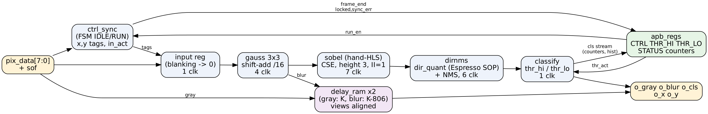
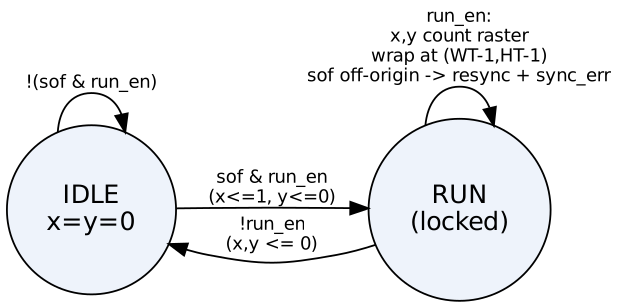
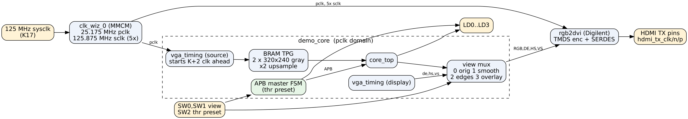

# P7 - Real-Time Edge-Detection Video Pipeline: final report (main pipeline)

Target: Digilent Zybo Z7-10 (xc7z010clg400-1), HDMI output only. Everything below is traceable to a log in `sim/reports/` or
`synth/`; this file is generated by `scripts/make_report.py` from those logs (numbers are not typed by hand).

## 1. Executive summary - what ran and what did not

| item | status | evidence |
|---|---|---|
| Golden model (`model/golden.py`), every stage saved, 8-panel composite per image | done | `model/stages/`, `doc/figures/progression/*.png`, `scripts/selfcheck_golden.py` (vector model == independent per-pixel loop model) |
| Hand-HLS Sobel (doc written first) -> `rtl/sobel.sv` | done | `doc/hand_hls_sobel.md` |
| `ctrl_sync`, `vga_timing` (+ docs) | done, simulated | `tb_ctrl_sync`, `tb_vga_timing`, `doc/vga_timing.md` |
| `dirnms` with a real Espresso run | done (pyeda's Espresso binding) | `doc/n4_espresso_results.md`, `sim/reports/espresso_dirnms.log` |
| `apb_regs` + `doc/register_map.md` | done, simulated (APB3, RV32 core not built) | `tb_top` APB readbacks |
| Pixel-exact match RTL vs golden, >=5 images | **done: 10 images, 0 mismatches** | section 4 |
| Vivado OOC synthesis, WNS/WHS/fmax | **NOT DONE - Vivado not available here.** Yosys resource estimates (clearly labelled) + ready-to-run TCL | section 5 |
| 3-way comparison table | done (resources = Yosys estimate; quality = golden-model, bit-identical to RTL) | section 7 |
| Formal CTL (`ctrl_sync`) + mutants | done with **NuSMV-A (NuSMV 2.6.0 fork), not nuXmv** (nuXmv download blocked) | section 8 |
| `zybo_top.sv`, XDC, Clocking Wizard TCL, rgb2dvi integration | written; data path simulated (`tb_demo`); **never synthesised, implemented or run on hardware** | section 9 |
| Bitstream | **NOT produced** (needs Vivado). `scripts/vivado/build_all.tcl` produces it | `doc/bringup_steps.md` |
| ILA on the board | to be done by you; click-by-click steps in `doc/bringup_steps.md` | |

## 2. Architecture



* Streaming, II = 1, one pixel per clock, **never stalled**. The core processes the whole 800 x 525 raster (active 640 x 480); blanking
  supplies the flush lines. Each stage carries an (x, y) tag; the valid region shrinks by 1 pixel per side per 3x3 stage (margins 1, 2, 3).
* Golden rules (identical in `golden.py` and RTL): gray = (77R+150G+29B)>>8; Gaussian [1 2 1;2 4 2;1 2 1]/16 by shift-add with +8 rounding;
  Sobel |Gx|+|Gy|; 4 direction sectors from |Gy|*32 <= |Gx|*13 and mirrors; NMS keep iff m >= a and m > b (asymmetric tie rule, `doc/nms_rule.md`);
  classes strong = nms >= THR_HI, weak = nms >= THR_LO (defaults 192 / 64).
* `ctrl_sync` FSM (verified in section 8):



### Golden-model progression (examples; all 10 in `doc/figures/progression/`)


## 3. Hand HLS and Espresso (details in their own docs)
* Sobel: shared terms E1 = p22-p00, E2 = p02-p20, F = p12-p10, G = p21-p01; Gx = E1+E2+2F, Gy = E1-E2+2G. Adders 10 -> 8, tree height 5 -> 3,
  six-stage II = 1 schedule (`doc/hand_hls_sobel.md`).
* Espresso (pyeda binding; `espresso-logic` was not installable): before 13 terms / 52 literals -> after 6 terms / 19 literals
  with don't-cares (without don't-cares 7 / 23); the minimised cover is checked equal to the specification on every care input (`verified: True`).

## 4. Verification results (iverilog, all real runs)
* Unit tests (`scripts/run_unit_all.sh`): `---- summary: 44 PASS, 0 FAIL`  (ctrl_sync, linebuf, rgb2gray, gauss, sobel, dirq, dirnms, classify; the per-image ones on 6 real + 4 synthetic 64x48 images).
* Full chain, 640 x 480, 3 back-to-back frames per image, random garbage on the bus during blanking, per-stage taps compared with the golden model
  (blur, Gx/Gy/mag, NMS+direction, class, aligned views), APB readbacks incl. a mid-frame threshold change (`scripts/run_top_all.sh`):

```
tb_top[camera]: 3 frames, 6288630 checks | blur 0  sobel 0  nms/dir 0  cls 0  views 0  apb 0 mismatches | strong px frame0=6070  PASS
tb_top[astronaut]: 3 frames, 6288630 checks | blur 0  sobel 0  nms/dir 0  cls 0  views 0  apb 0 mismatches | strong px frame0=10484  PASS
tb_top[coins]: 3 frames, 6288630 checks | blur 0  sobel 0  nms/dir 0  cls 0  views 0  apb 0 mismatches | strong px frame0=8936  PASS
tb_top[coffee]: 3 frames, 6288630 checks | blur 0  sobel 0  nms/dir 0  cls 0  views 0  apb 0 mismatches | strong px frame0=6928  PASS
tb_top[chelsea]: 3 frames, 6288630 checks | blur 0  sobel 0  nms/dir 0  cls 0  views 0  apb 0 mismatches | strong px frame0=927  PASS
tb_top[rocket]: 3 frames, 6288630 checks | blur 0  sobel 0  nms/dir 0  cls 0  views 0  apb 0 mismatches | strong px frame0=3155  PASS
tb_top[syn_flat]: 3 frames, 6288630 checks | blur 0  sobel 0  nms/dir 0  cls 0  views 0  apb 0 mismatches | strong px frame0=0  PASS
tb_top[syn_checker]: 3 frames, 6288630 checks | blur 0  sobel 0  nms/dir 0  cls 0  views 0  apb 0 mismatches | strong px frame0=34610  PASS
tb_top[syn_pixline]: 3 frames, 6288630 checks | blur 0  sobel 0  nms/dir 0  cls 0  views 0  apb 0 mismatches | strong px frame0=2212  PASS
tb_top[syn_stepedge]: 3 frames, 6288630 checks | blur 0  sobel 0  nms/dir 0  cls 0  views 0  apb 0 mismatches | strong px frame0=789  PASS
---- summary: 10 PASS, 0 FAIL
```
  Checks start K = 2422 cycles after the first frame origin (before that the stage taps show the not-yet-existing previous frame).
* Non-vacuity: a deliberately broken `linebuf` (wrong write column) makes `tb_linebuf` FAIL (21108 mismatches); a deliberately mis-aligned demo
  (mutant, below) makes `tb_demo` FAIL.
* VGA timing (`tb_vga_timing`):
```
measured: hsync period 800 clk (exp 800), hsync low 96 clk (exp 96), vsync period 420000 clk (exp 420000), vsync low 1600 clk (exp 1600 = 2 lines)
active pixels counted over the run: 614400  (per frame exp 307200)
frame rate at 25.175 MHz = 25175000/420000 = 59.940476 Hz
tb_vga_timing: PASS
```
* Demo data path, 5 source frames, both BRAM images, threshold switch inside frame 2, 4 views (`tb/tb_demo.sv`): `tb_demo: 8244004 checks, strong px seen 25471 | tag 0 gray 0 blur 0 cls 0 vid 0 sync 0 thr 0 mismatches | images used: img0 x3, img1 x2 frames | PASS`
  Mutant (display timing misaligned by 1 clock, `SRC_LAT = 1`): `tb_demo: 8244004 checks, strong px seen 25471 | tag 1536001 gray 609421 blur 997376 cls 95485 vid 445406 sync 0 thr 0 mismatches | images used: img0 x3, img1 x2 frames | FAIL`
* Paper RTL cross-check (untouched reference RTL; one rename `bins` -> `hist_bins` because `bins` is a keyword for Icarus), 640x480 on our NMS magnitudes vs. the Python model:
```
paper RTL [camera]: t_hi=102 t_lo=51 nstrong=11008 nweak=16886 (class stream 307200 px) | model t_hi=102 t_lo=51 nstrong=11008 nweak=16886 | PASS
paper RTL [coins]: t_hi=98 t_lo=49 nstrong=19875 nweak=12273 (class stream 307200 px) | model t_hi=98 t_lo=49 nstrong=19875 nweak=12273 | PASS
```
  (The reference notes said that RTL had never been simulated; this is its first real simulator run.)

## 5. Resources, timing, latency
**Vivado was not available.** There is therefore **no real WNS / WHS / fmax** in this report - writing one would be a fabrication.
`scripts/vivado/ooc_synth.tcl` / `ooc_impl.tcl` produce them (`create_clock` 10 ns; fmax ~ 1000 / (10 - WNS)). Resource numbers are from
Yosys 0.33 `synth_xilinx` (`scripts/yosys_synth_all.sh`); LUT/FF/BRAM counts of a different tool can differ by tens of percent.

| design (Yosys 0.33 `synth_xilinx`, xc7, **estimate, not Vivado**) | LUT (LUT1-6) | SRL16E | FF | CARRY4 | RAMB36 | RAMB18 | BRAM36-equiv | DSP48E1 |
|---|---|---|---|---|---|---|---|---|
| OURS: core_top (full pipeline + APB + aligned views) | 865 | 73 | 1453 | 123 | 1 | 7 | 4.5 | 0 |
| BASELINE: plain Sobel + 1 threshold | 161 | 31 | 263 | 48 | 0 | 2 | 1 | 0 |
| PAPER system: our front end + paper_top (frame buffer, histogram, Otsu) | 8740 | 53 | 9317 | 254 | 75 | 6 | 78 | 13 |
| (paper_top alone, 640x480) | 8326 | 0 | 8690 | 160 | 75 | 0 | 75 | 13 |
| DEMO: demo_core (core + BRAM TPG + timing + APB master) | 658 | 73 | 771 | 122 | 35 | 7 | 38.5 | 1 |

LUT arithmetic for core_top: LUT1=1 + LUT2=203 + LUT3=95 + LUT4=196 + LUT5=134 + LUT6=236 = 865. BRAM36-equiv = RAMB36 + RAMB18/2 = 1 + 7/2 = 4.5
(line buffers, and the two view-alignment delay RAMs). DSP = 0: every multiplication is a shift-add.
The Zybo Z7-10 has 60 RAMB36: the **paper's frame buffer alone (75 RAMB36 for 640 x 480 x 8 bit) does not fit** the device; the streaming design needs 4.5.
The demo (two 320x240 images in BRAM) adds the ROM: demo_core = 38.5 BRAM36-equiv of 60 (Yosys). Unused APB read-back counters/histogram are optimised away in demo_core
because nothing reads them, which is why its LUT/FF counts are smaller than core_top's.

**Latency** (arithmetic in `doc/latency.md`): K = 3 x (WT+1) + 19 = 3 x 801 + 19 = 2422 clocks = 2422/800 = 3.0275 lines (3 lines + 22 pixels)
= 96.2 us at 25.175 MHz. The testbench confirms K (aligned views from t0+K onward, 0 mismatches).

## 6. Quality evaluation
Ground truth: `skimage.feature.canny(gray/255, sigma=1.0, low_threshold=0.1, high_threshold=0.2)` (my choice; numbers depend on it).
Metrics on the whole 640x480 frame, 6 natural images. PSNR is computed on the binary edge maps (peak = 1) and is low for every design because edge maps are sparse.

| design | map | mean PSNR [dB] | mean F1 (exact) | mean F1 (1-px tol) | mean edge px |
|---|---|---|---|---|---|
| OURS fixed 192/64 | strong | 11.89 | 0.338 | 0.407 | 6083 |
| OURS fixed 192/64 | strong+weak | 14.60 | 0.772 | 0.925 | 22973 |
| PAPER adaptive Otsu | strong (>=T_hi) | 13.64 | 0.685 | 0.829 | 19216 |
| PAPER adaptive Otsu | strong+weak (>=T_lo) | 13.38 | 0.741 | 0.877 | 33652 |
| BASELINE plain Sobel>=192 | binary | 10.95 | 0.380 | 0.569 | 16494 |

Per image (PSNR dB / F1 exact / F1 tol-1):

| image | GT edges | OURS strong | OURS s+w | PAPER strong (T_hi,T_lo) | PAPER s+w | BASELINE |
|---|---|---|---|---|---|---|
| camera | 24328 | 12.02 / 0.365 / 0.419 | 14.24 / 0.746 / 0.911 | 12.85 / 0.549 / 0.691 (102,51) | 13.73 / 0.751 / 0.894 | 10.74 / 0.363 / 0.539 |
| astronaut | 26204 | 12.37 / 0.515 / 0.599 | 15.00 / 0.809 / 0.942 | 13.64 / 0.695 / 0.806 (110,55) | 15.00 / 0.816 / 0.951 | 10.29 / 0.462 / 0.690 |
| coins | 28635 | 11.62 / 0.437 / 0.523 | 14.37 / 0.802 / 0.958 | 13.40 / 0.710 / 0.863 (98,49) | 14.06 / 0.802 / 0.951 | 10.19 / 0.444 / 0.691 |
| coffee | 28807 | 11.23 / 0.352 / 0.436 | 14.05 / 0.781 / 0.922 | 13.46 / 0.717 / 0.861 (84,42) | 12.67 / 0.750 / 0.877 | 10.59 / 0.434 / 0.637 |
| chelsea | 28979 | 10.37 / 0.057 / 0.082 | 13.10 / 0.714 / 0.893 | 12.36 / 0.725 / 0.884 (46,23) | 9.06 / 0.564 / 0.705 | 10.42 / 0.133 / 0.214 |
| rocket | 15441 | 13.72 / 0.299 / 0.383 | 16.84 / 0.783 / 0.924 | 16.11 / 0.716 / 0.871 (80,40) | 15.78 / 0.765 / 0.887 | 13.46 / 0.441 / 0.643 |

Reading: with the fixed thresholds 192/64 the **strong-only** map is conservative (low recall); strong+weak (no hysteresis linking is implemented in the brief's classifier) is much closer to Canny.
The paper's adaptive Otsu threshold (computed on the 8-bit-saturated NMS histogram) lands near T_hi = 46..110 and so marks many more pixels as edges.
These conclusions hold for this GT and these images only. Baseline = plain Sobel >= 192 on the unsmoothed gray image (my definition; the brief's baseline definition was not in the material I received).

## 7. 3-way comparison (resources are Yosys estimates)

| | OURS (fixed thr, streaming) | PAPER (adaptive Otsu, frame buffer) | BASELINE (plain Sobel) |
|---|---|---|---|
| LUT / FF | 865 / 1453 | 8740 / 9317 | 161 / 263 |
| BRAM36-equiv | 4.5 | 78 (does not fit Z7-10) | 1 |
| DSP48E1 | 0 | 13 | 0 |
| quality | section 6 | section 6 | section 6 |
| latency | 2422 clk (3.03 lines) | >= 1 full frame (frame buffer: load, histogram, Otsu sweep, then classify = whole frame stored first) | 1 + (WT+1) + 7 + 1 = 810 clk (1 line + 10 px; input reg, line-buffer wait, Sobel, output reg) |

PAPER = our front end (gauss, sobel, dirnms) feeding the paper's frame buffer + histogram + log-domain Otsu + classifier, because the reference zip only holds the threshold stage
(`FINAL_PAPER_REIMPLEMENTATION_REPORT.md` was *not* in the zip, so the paper column is measured here and not copied). The paper system lacks our view-alignment RAMs and APB registers, so the comparison is not perfectly like-for-like.

## 8. Formal verification (NuSMV-A, CTL) - `formal/ctrl_sync.smv`, mutants in `formal/mutants/`
Model: tiny raster (WT=4, HT=3, active 3x2), `sof` and `run_en` free inputs. Properties (all TRUE on the real model): AG EX TRUE; AG EF st=IDLE; AG(st=RUN -> EF st=IDLE) [can return to idle];
AG((st=RUN & !run_en) -> AX st=IDLE); AG EF frame_start [a new frame can always start]; AG x<=WT-1; AG y<=HT-1 [counters in bounds]; AG(st=IDLE -> x=0&y=0);
wrap-around property; AG EF frame_end; plus `check_fsm` (no deadlock).

```
==== SUMMARY  (T = property TRUE, F = FALSE i.e. bug caught) ====
property legend:
  P1: AG (EX TRUE)
  P2: AG (EF st = IDLE)
  P3: AG (st = RUN -> EF st = IDLE)
  P4: AG ((st = RUN & !run_en) -> AX st = IDLE)
  P5: AG (EF frame_start)
  P6: AG x <= WT - 1
  P7: AG y <= HT - 1
  P8: AG (st = IDLE -> (x = 0 & y = 0))
  P9: AG (((((st = RUN & last_x) & last_y) & run_en) & !(sof & !at_origin)) -> AX ((x = 0 & y = 0) & st = RUN))
  P10: AG (EF frame_end)
  P11: DF: check_fsm deadlock-free

                       P1  P2  P3  P4  P5  P6  P7  P8  P9 P10 P11
ORIGINAL                T   T   T   T   T   T   T   T   T   T   T
M1_y_never_wraps        T   T   T   T   T   T   F   T   F   T   T
M2_frame_end_trap       T   F   F   F   F   T   T   T   F   T   T
M3_idle_keeps_x         T   T   T   T   T   T   T   F   T   T   T
M4_abort_ignored        T   F   F   F   T   T   T   T   T   T   T
M5_dead_state           T   T   T   T   T   T   T   T   T   T   F
M6_x_wraps_to_1         T   T   T   T   T   T   T   T   F   T   T
M7_line_too_long        T   T   T   T   T   F   T   T   T   T   T
M8_frame_too_short      T   T   T   T   T   T   T   T   T   F   T

original: all 11 properties TRUE = True
M1_y_never_wraps: caught by ['P7', 'P9']
M2_frame_end_trap: caught by ['P2', 'P3', 'P4', 'P5', 'P9']
M3_idle_keeps_x: caught by ['P8']
M4_abort_ignored: caught by ['P2', 'P3', 'P4']
M5_dead_state: caught by ['P11']
M6_x_wraps_to_1: caught by ['P9']
M7_line_too_long: caught by ['P6']
M8_frame_too_short: caught by ['P10']
properties that stayed TRUE on every mutant (not exercised by any mutant): ['P1']
```

Every mutant is caught by at least one property. Honest finding: `AG EX TRUE` (P1) stayed TRUE on every mutant - including the real deadlock mutant M5 - because NuSMV's `EX` ignores deadlock states, so P1 is
**vacuous** as a deadlock check; the `check_fsm` result (P11) is what catches M5. P1 is kept for completeness but must not be counted as evidence.
Known limit: the proofs hold for the small model; the RTL <-> model correspondence was reviewed by hand and checked indirectly by `tb_ctrl_sync` / `tb_top`, not by a formal equivalence tool.

## 9. Demo (zybo_top) - written, NOT built

* `rtl/zybo_top.sv` = Clocking Wizard (`clk_wiz_0`, 125 -> 25.175 / 125.875 MHz) + Digilent `rgb2dvi` (`hdmi/`, MIT licence, TMDS not hand-written) + `demo_core`.
  `demo_core` = source `vga_timing` (started K+2 clocks ahead) -> BRAM test-pattern ROM (2 images, 320x240 upsampled x2) -> `core_top` -> view mux -> display `vga_timing` (`doc/vga_timing.md`).
* Controls (3 switches only): SW0/SW1 = 2-bit view (original / smoothed / edges / edge overlay), SW2 = threshold preset 192/64 or 300/120, written through an APB master FSM (`doc/top_controller.md`).
  Reset comes from the MMCM lock. The image alternates automatically every 128 frames (no spare input for a selector).
* `constraints/zybo.xdc`: clk K17 kept; SW0/1/2 -> `sw_view[0]`, `sw_view[1]`, `sw_thr`; LEDs -> `led[0..3]`; **only** the HDMI-TX block uncommented (hdmi_tx_hpd/scl/sda, clk n/p, data n/p[0..2]); one extra line
  uncommented: `create_clock` for the 125 MHz sysclk (needed for timing). The rgb2dvi core's own ports are `TMDS_*`; they are wrapped in `zybo_top` and the pins carry the `hdmi_tx_*` names.
* Not verified because there is no Vivado/board: that the TCL scripts run unchanged; the exact MMCM frequencies; that the `hdmi_tx_hpd` input / DDC lines behave as assumed
  (hpd as input, scl/sda released); timing closure at 25.175 MHz (very likely easy, but unmeasured); the picture on a monitor.

## 10. Deviations and honesty list
1. `model/golden.py`, the test images and `FINAL_PAPER_REIMPLEMENTATION_REPORT.md` were not in the zip -> golden model re-written from the brief's rules; images = scikit-image bundled images (camera, astronaut, coins, coffee, chelsea, rocket, cropped to 4:3 and resized) + 4 synthetic; paper numbers measured here.
2. The master-plan PDF was not available; the brief and the problem-statement image agree.
3. nuXmv not obtainable -> NuSMV-A. espresso-logic not obtainable -> pyeda's Espresso. Vivado absent -> Yosys estimates, no WNS/WHS/fmax, no bitstream.
4. The paper RTL needed one keyword rename to compile in Icarus (copy in `sim/paper_patched/`, original untouched).
5. RV32 core not built (optional); APB3 slave is compatible.
6. `doc/worklog.md`: first four entries share one batch timestamp (disclosed there).

## 11. Reproduce
```
python3 scripts/gen_main_vectors.py && python3 scripts/make_progression.py   # vectors + composites
scripts/run_unit_all.sh                    # 44 unit tests
scripts/run_top_all.sh                     # 10 images, full chain  (~15 min)
python3 scripts/gen_demo_vectors.py && vvp -n sim/build/tb_demo.vvp   # see tb_demo build line in scripts/sim.sh style (iverilog -g2012 core files + rtl/vga_timing.sv rtl/demo_core.sv tb/tb_demo.sv)
python3 scripts/run_formal.py              # NuSMV-A CTL + 8 mutants
scripts/yosys_synth_all.sh                 # resource estimates
python3 scripts/eval_quality.py            # PSNR / F-score table
scripts/paper_rtl_check.sh                 # untouched paper RTL vs model
python3 scripts/make_report.py             # regenerate this file
vivado -mode batch -source scripts/vivado/ooc_synth.tcl   # on a machine with Vivado: real WNS/WHS/fmax (not run here)
vivado -mode batch -source scripts/vivado/build_all.tcl   # bitstream (not run here)
```
