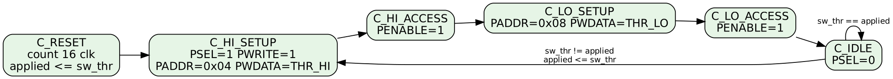

# Top-level controller (in `rtl/demo_core.sv`)

**Choice (asked in the brief): thresholds are written through APB, not read from switches directly.**
Only three switches exist in the given XDC (SW0 G15, SW1 P15, SW2 W13). Two of them select the view, so one switch is
left for the thresholds: `sw_thr` selects one of two **presets** (A = THR_HI/LO 192/64, B = 300/120). A tiny APB3 master
FSM writes the preset into THR_HI (0x04) and THR_LO (0x08) of `apb_regs`:

* after reset (MMCM locked) it waits 16 clocks, latches the switch into `applied`, and writes the pair;
* whenever the synchronised switch differs from `applied` it writes again (the core latches the new pair at the next frame end,
  so a frame is never classified with half-old thresholds - see `doc/register_map.md`, "Latching");
* each write is a standard 2-phase APB3 transfer (SETUP: PSEL=1/PENABLE=0, ACCESS: PENABLE=1; PREADY is constantly 1).

The same bus is what an RV32 core (optional in the brief, **not** implemented) would drive; nothing else would change.
The reset of the whole demo is derived from the clocking-wizard `locked` flag, so no reset switch is needed (SW3 remains unused).
Switch inputs go through a 2-flip-flop synchroniser; the view mux itself only changes the pixel colour, never the timing.

LED map: LD0 heartbeat (frame-counter bit 4, toggles every 16 source frames), LD1 core `locked`, LD2 sync error ever seen (lit = bad),
LD3 preset B applied.

The first-frame data path is exercised in `tb/tb_demo.sv` (APB write sequence is the real RTL, preset switched mid-frame).
